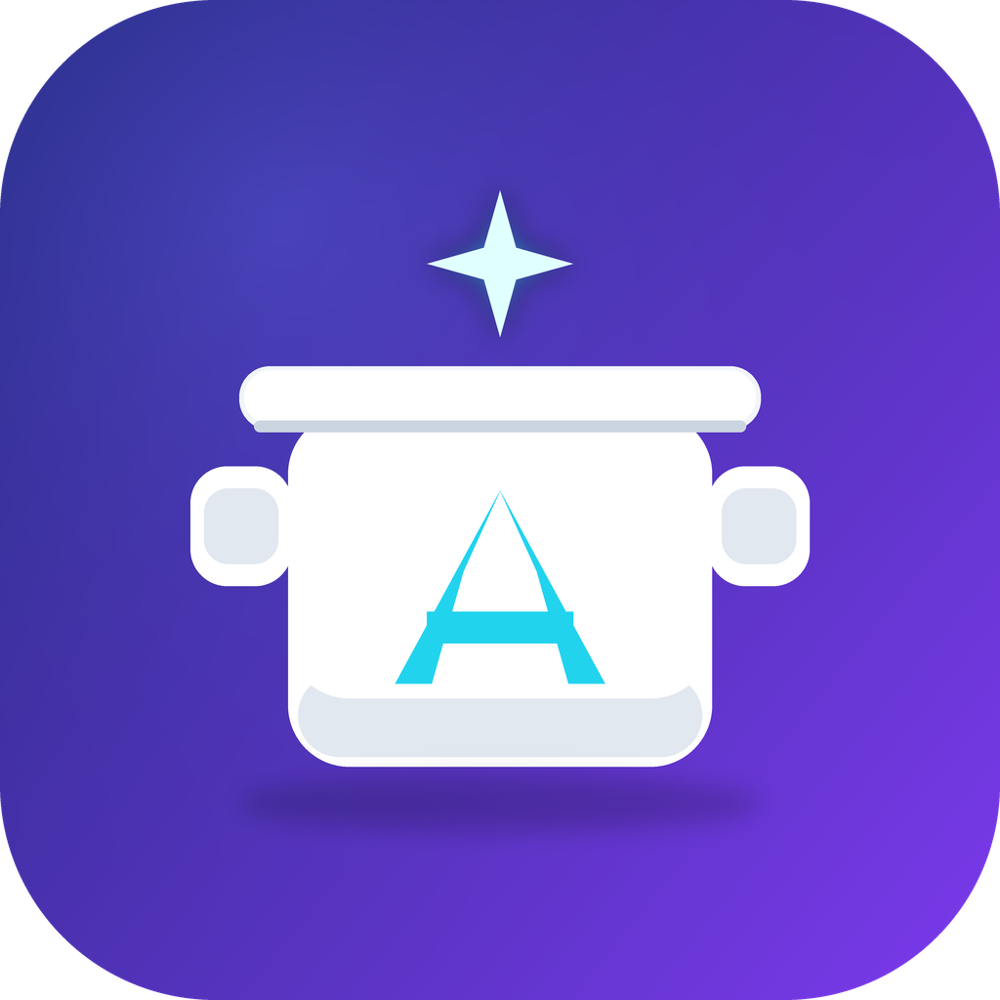
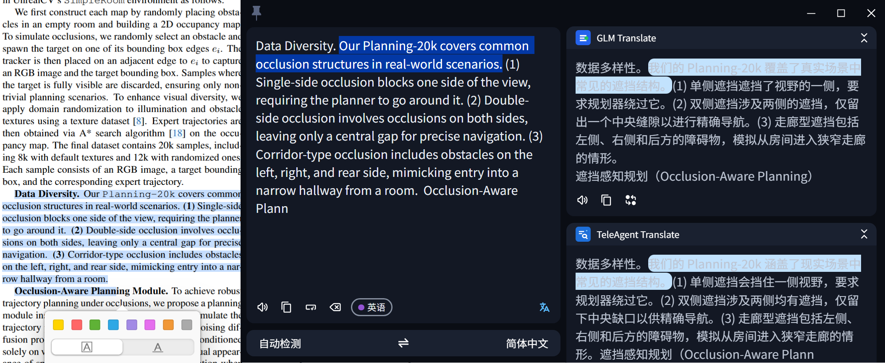
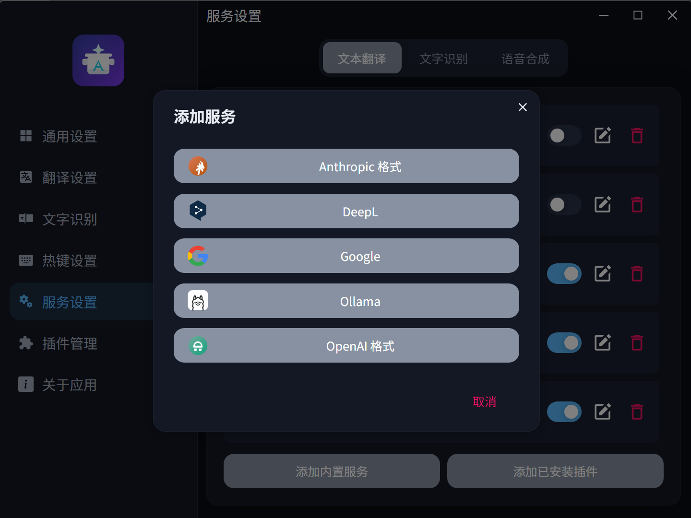
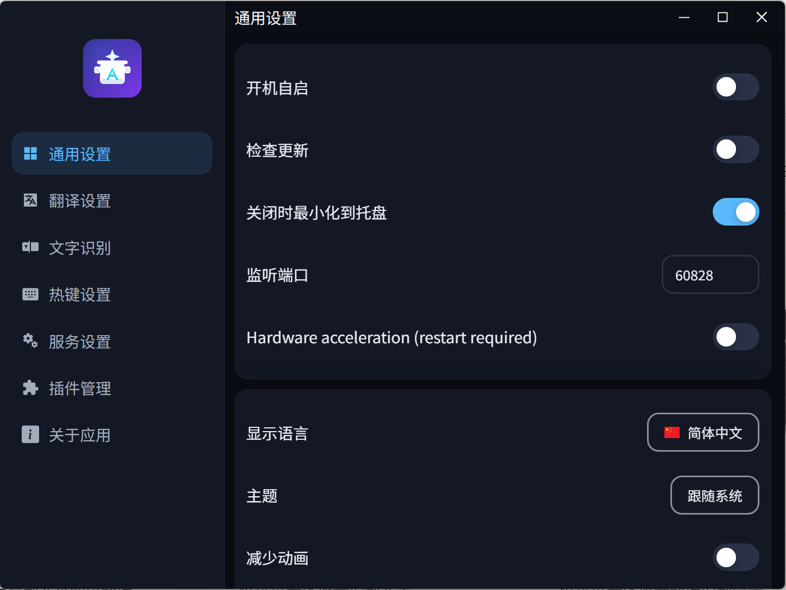
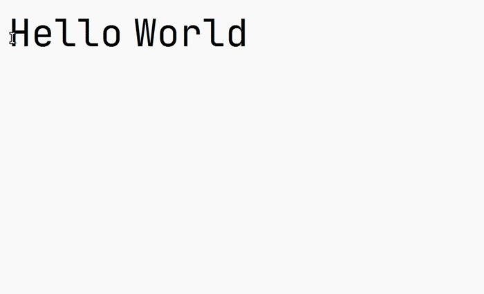
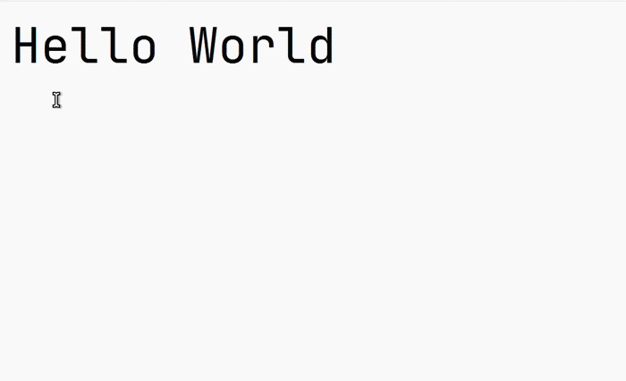
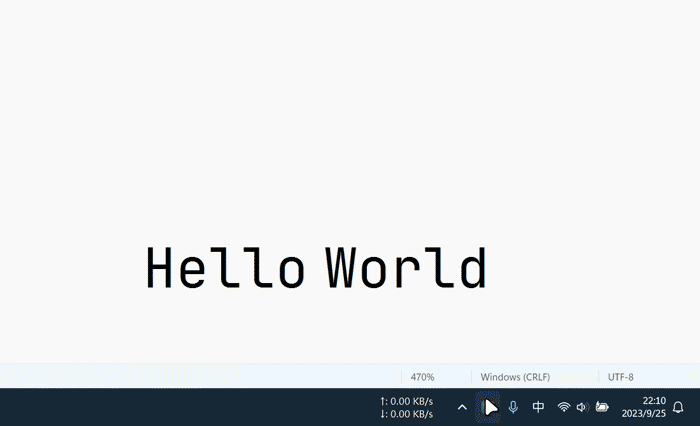
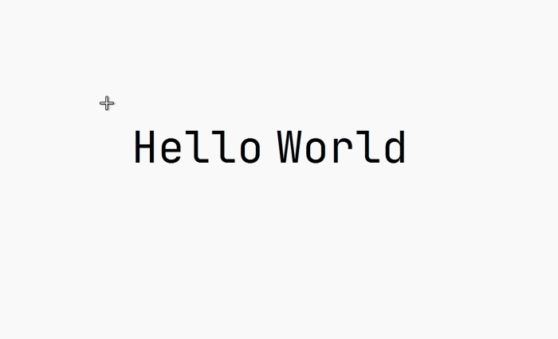
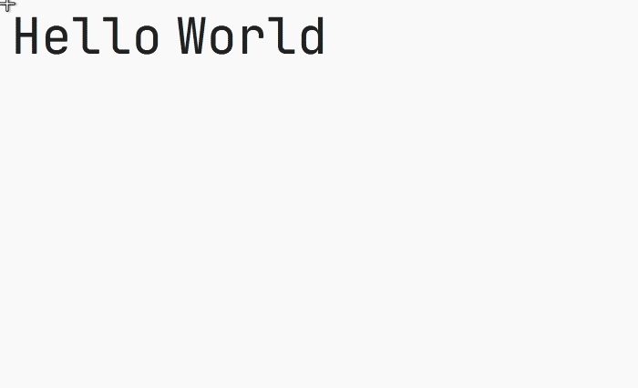

<p align="center">
  
</p>

<h1 align="center">AiPot</h1>

<p align="center">
  An AI-powered text selection translation, input translation, screenshot OCR, and screenshot translation tool for Windows and Linux.
</p>

<p align="center">
  <span>English</span>
  |
  <a href="README.md">简体中文</a>
</p>

<p align="center">
  
  
  
  
  
</p>

> AiPot is a self-maintained fork of [NeoPot](https://github.com/shirumesu/NeoPot), which continues
> [Pot Desktop](https://github.com/pot-app/pot-desktop) on Electron, HeroUI, and TypeScript.
> This fork focuses on **built-in LLM integration, reading experience, performance, and smoother
> interactions**. The macOS build is not distributed yet (signing requires an Apple Developer account).
>
> Development notes live in [`docs/README.md`](docs/README.md).

## 🌟 Highlights (vs. NeoPot)

Based on NeoPot 1.1.10 (current version 1.4.2), the main improvements are:

| Improvement | Details |
| --- | --- |
| **Built-in OpenAI / Claude-format LLM services** | New built-in `OpenAI format` and `Anthropic format` translation services: custom service name, API key, request URL, model list (fetchable online), and prompt templates (`$text` / `$to` placeholders). Any OpenAI- or Claude-compatible gateway or local inference service works out of the box — no plugin needed |
| **DeepL-style dual-column reading** | The translation window was redesigned from a single stacked column into a **side-by-side dual-column layout**: source on the left, per-service results on the right, with **click-to-align sentence highlighting** (DeepL-style alignment) for long-form and paper reading |
| **Lower memory & faster wake-up** | Hardware acceleration off by default, idle hidden-window recycling, and lazy loading of the first screen and OCR models: idle memory drops from ~421 MB to **~122 MB**, selection capture from 700–900 ms to **~120 ms**, and cold renderer ready in ~540 ms |
| **More reliable selection capture** | A native selection helper (`AiPotSelectionHelper`: foreground window locking + clipboard sequence listener + UIA fallback) fixes selection failures on apps that never copy selected text to the clipboard; the PowerShell fallback was also rewritten |
| **Smoother menus and interactions** | New "night-sky blue" dual themes, a flat first-level settings navigation with spring page transitions; fixed hotkey wake-up flicker and a blank-page deadlock when switching settings pages quickly; saving settings no longer spams success toasts |

See [`docs/CHANGES_FROM_UPSTREAM.md`](docs/CHANGES_FROM_UPSTREAM.md) for the full change list.

## Feature Preview

<p align="center">
  
</p>

<p align="center"><sub>DeepL-style dual-column layout: source text on the left, per-service results on the right, with click-to-align sentence highlighting.</sub></p>

| Built-in LLM services                                                       | Redesigned settings                                               | Idle memory (5 processes)                                    |
| --------------------------------------------------------------------------- | ----------------------------------------------------------------- | ------------------------------------------------------------- |
| OpenAI / Anthropic formats out of the box                                   | General settings page                                             | ~122 MB                                                       |
|  |  |  |

| Selection Translation                                                     | Input Translation                                                     | External Invocation                                                     |
| ------------------------------------------------------------------------- | --------------------------------------------------------------------- | ----------------------------------------------------------------------- |
| Select text and press a shortcut to translate it                          | Open the translation window, enter text, and press Enter              | Invoke AiPot from other tools through the local HTTP API                |
|  |  |  |

| Clipboard Monitoring                                                     | Screenshot OCR                                                     | Screenshot Translation                                                     |
| ------------------------------------------------------------------------ | ------------------------------------------------------------------ | -------------------------------------------------------------------------- |
| Translate copied text after enabling clipboard monitoring                | Select a screen region and recognize text                          | Select a screen region and translate the recognized result                 |
|  |  |  |

## Table of Contents

- [Feature Preview](#feature-preview)
- [Main Features](#main-features)
- [Supported Services](#supported-services)
- [Installation](#installation)
- [Plugin System](#plugin-system)
- [External Invocation](#external-invocation)
- [Wayland Support](#wayland-support)
- [Development and Build](#development-and-build)
- [Acknowledgements](#acknowledgements)

## Main Features

- Built-in OpenAI / Anthropic format LLM translation services
- Parallel translation with multiple services
- Local-model text recognition
- Text-to-speech through plugins
- Screenshot OCR and screenshot translation (transparent direct selection)
- Clipboard monitoring translation
- Local HTTP API for external invocation
- Plugin extension system
- Windows and Linux support
- External screenshot invocation support for Wayland
- Multilingual interface

## Supported Services

The current version ships these built-in services:

<details>
<summary>Translation</summary>

- OpenAI format (any OpenAI-compatible LLM)
- Anthropic format (any Claude-compatible LLM)
- Google
- DeepL
- Ollama

</details>

<details>
<summary>Text Recognition</summary>

- Local Model OCR (PaddleOCR.js PP-OCRv5)

</details>

<details>
<summary>Text-to-Speech</summary>

- Plugin support only

</details>

**More translation engines and services** can be added through the plugin system. Open the built-in plugin marketplace to browse community plugins.  
Welcome to contribute to the upstream [plugin marketplace](https://github.com/shirumesu/Neopot-releases).

## Installation

This fork is distributed as the dist/ artifacts produced by pnpm run make.

### Windows

- `AiPot-Setup-{version}.exe`: 64-bit Windows installer
- `AiPot-{version}-portable-x64.exe`: 64-bit Windows portable build

### Linux

The release page provides `deb`, `rpm`, and `AppImage` packages. On Debian/Ubuntu, you can install the downloaded deb file directly:

```bash
sudo apt-get install ./AiPot-*.deb
```

Arch, Manjaro, Flatpak, Homebrew, Winget, and other distribution channels have not been connected to AiPot yet. Use this repository's build artifacts.

## Plugin System

AiPot supports extending translation, OCR, and text-to-speech functionality through plugins.

**Installation methods**:

- Install directly from the built-in plugin marketplace
- Import `.zip` plugin packages
- Select local plugin directories (for development)

Plugins can add new translation engines, OCR services, and TTS providers. Developers can refer to templates and documentation in the [upstream plugin marketplace](https://github.com/shirumesu/Neopot-releases) to create their own plugins.

## External Invocation

AiPot provides a local HTTP API. The default port is `60828`, and it can be changed in settings.

```text
POST "/"                                  Translate text in the request body
GET  "/config"                            Open settings
POST "/translate"                         Translate text in the request body
GET  "/selection_translate"               Selection translation
GET  "/input_translate"                   Input translation
GET  "/ocr_recognize"                     Screenshot OCR
GET  "/ocr_translate"                     Screenshot translation
GET  "/ocr_recognize?screenshot=false"    Use an external screenshot file for OCR
GET  "/ocr_translate?screenshot=false"    Use an external screenshot file for screenshot translation
```

Example:

```bash
curl "127.0.0.1:60828/selection_translate"
```

### SnipDo

Windows users can install SnipDo from the Microsoft Store. The SnipDo extension source code is located in the `.scripts/snipdo/` directory and can be built into a `.pbar` file for installation.

## Wayland Support

Linux global shortcuts may be limited by the desktop environment on Wayland. Wayland users can bind shortcuts through their desktop environment or window manager, then use `curl` to call AiPot’s local HTTP API.

Hyprland external screenshot example:

```conf
bind = ALT, X, exec, grim -g "$(slurp)" ~/.cache/aipot/pot_screenshot_cut.png && curl "127.0.0.1:60828/ocr_recognize?screenshot=false"
bind = ALT, C, exec, grim -g "$(slurp)" ~/.cache/aipot/pot_screenshot_cut.png && curl "127.0.0.1:60828/ocr_translate?screenshot=false"
```

Floating window example:

```conf
windowrulev2 = float, class:(aipot), title:(Translator|OCR|Screenshot Translate)
windowrulev2 = move cursor 0 0, class:(aipot), title:(Translator|Screenshot Translate)
```

## Development and Build

### Technology Stack

- **Desktop framework**: Electron 41+ with electron-vite
- **Frontend**: React 19, TypeScript, Vite 7
- **UI framework**: HeroUI, Tailwind CSS 4
- **State management**: Jotai
- **Internationalization**: i18next

### Environment Requirements

Verified environment:

- Node.js `>= 24.0.0`
- pnpm `>= 9`

### Getting Started

Clone the repository:

```bash
git clone git@github.com:wangjiaqi886/AiPot.git
cd AiPot
pnpm install
```

Linux packaging tools (optional, only for building deb/rpm):

```bash
sudo apt-get install -y rpm
```

Common commands:

```bash
pnpm run dev
pnpm run lint
npm run test
pnpm run format
pnpm run make
```

`npm run test` is the complete local quality gate before committing. See
[`tests/README.md`](tests/README.md) for the fast, coverage, and Electron journey layers.

## Acknowledgements

AiPot is derived from [NeoPot](https://github.com/shirumesu/NeoPot), which is derived from [Pot Desktop](https://github.com/pot-app/pot-desktop). This project continues to use the GPL-3.0-only license. Thanks to the original projects and their plugin ecosystems for their long-term contributions.

> AI生成
