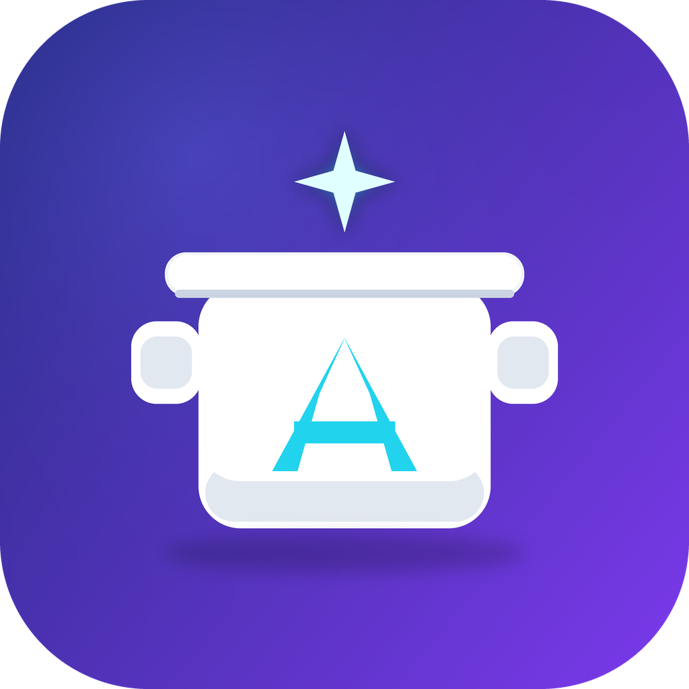
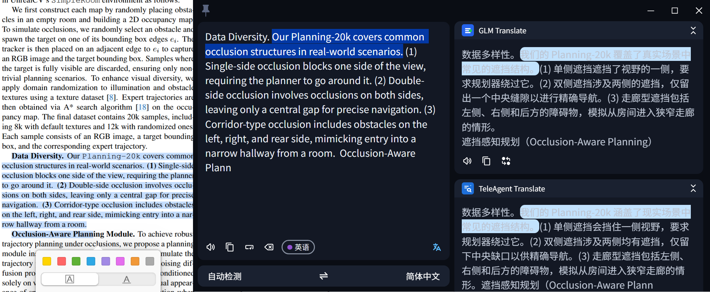
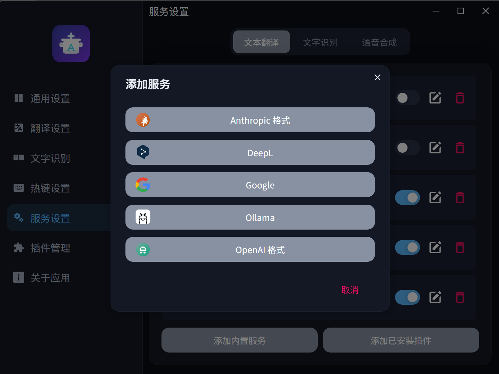
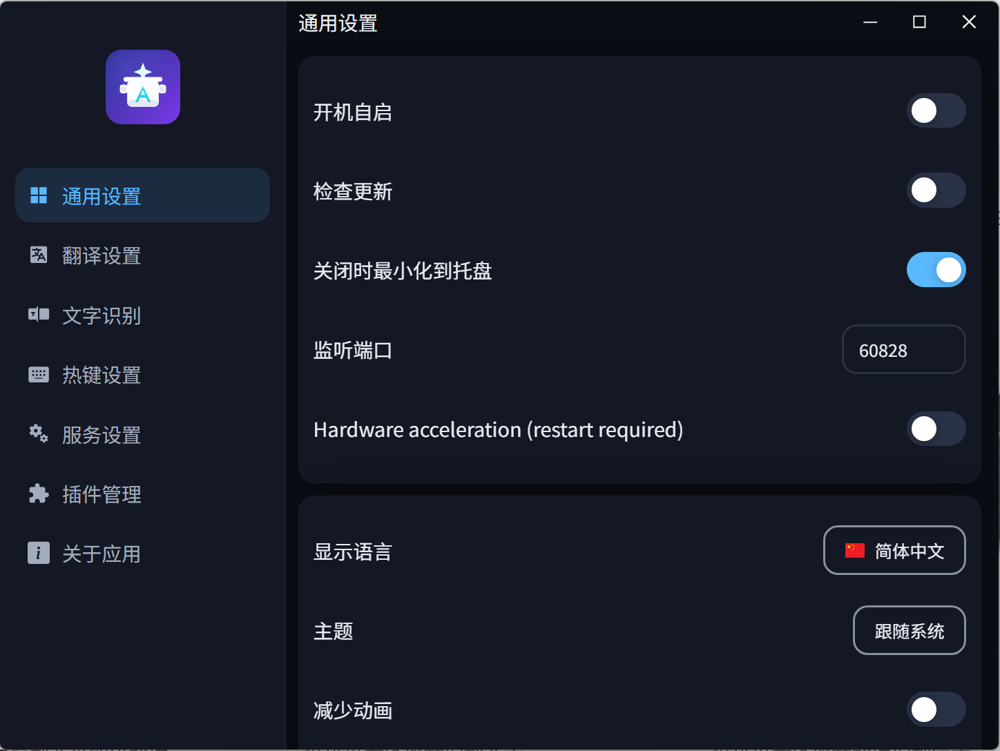
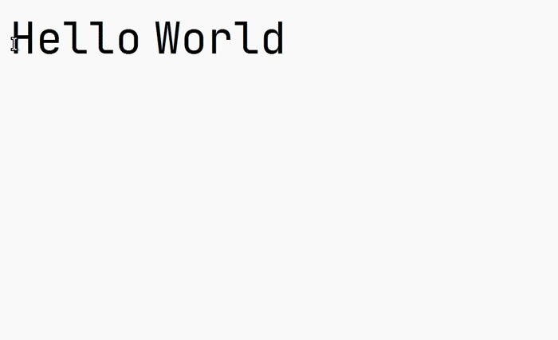
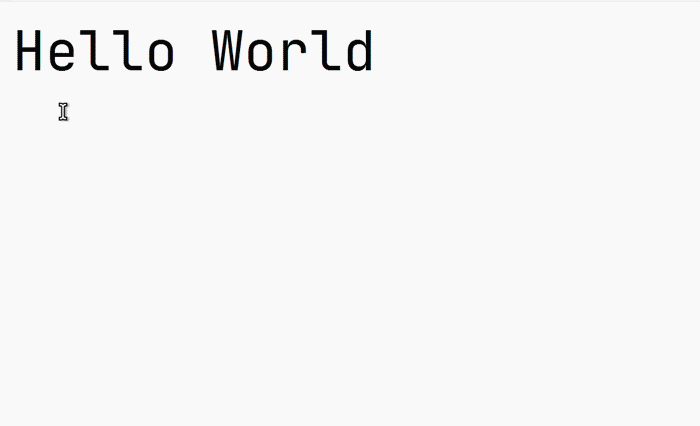
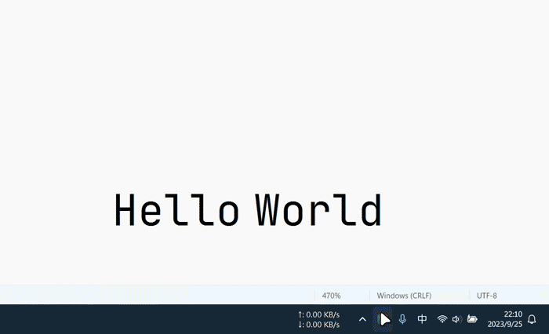
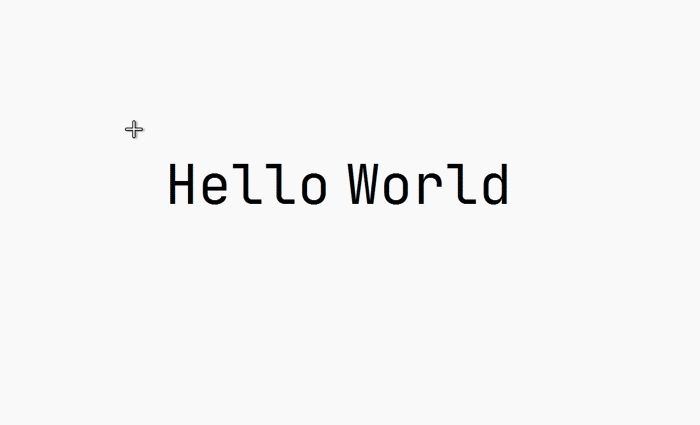
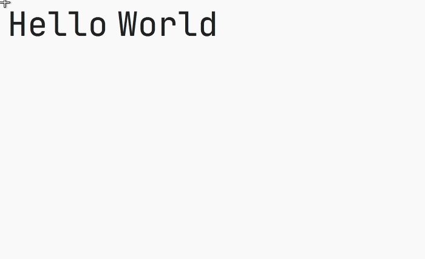

<p align="center">
  
</p>

<h1 align="center">AiPot</h1>

<p align="center">
  面向 Windows 和 Linux 的 AI 驱动划词翻译、输入翻译、截图 OCR 与截图翻译工具。
</p>

<p align="center">
  <a href="README.en.md">English</a>
  |
  <span>简体中文</span>
</p>

<p align="center">
  
  
  
  
  
</p>

> AiPot 是 [NeoPot](https://github.com/shirumesu/NeoPot) 的自建分支（fork）。NeoPot 源自
> [Pot Desktop](https://github.com/pot-app/pot-desktop) 并迁移到 Electron、HeroUI 与 TypeScript。
> 本分支在此基础上围绕**大模型接入、阅读体验、性能与交互流畅度**持续演进；macOS 版本暂不发布
> （分发需要 Apple Developer 账号签名公证）。
>
> 开发文档、构建流程与踩坑记录见 [`docs/README.md`](docs/README.md)。

## 🌟 本版重点改进（相对 NeoPot）

基于 NeoPot 1.1.10（当前版本 1.4.2），本分支的改进集中在以下方向：

| 改进 | 说明 |
| --- | --- |
| **内置 OpenAI / Claude 格式大模型接入** | 新增 `OpenAI 格式` 与 `Anthropic 格式` 内置翻译服务：自定义服务名、API Key、请求地址、模型列表（支持在线拉取）、Prompt 模板（`$text` / `$to` 占位符），任何 OpenAI 兼容或 Claude 兼容的大模型网关与本地推理服务均可直接接入，无需插件 |
| **DeepL 式双栏阅读体验** | 翻译窗口由单列堆叠改版为**左右双栏对照**：左侧原文，右侧各服务译文；支持**点击句子双语同步高亮**（DeepL 式句子对齐），论文 / 长文阅读中可逐句对照 |
| **内存占用与唤醒延迟优化** | 默认禁用硬件加速、隐藏窗口闲置回收、首屏按需加载与 OCR 模型延迟导入：空闲内存由约 421 MB 降至 **约 122 MB**，划词捕获耗时由 700–900 ms 降至 **约 120 ms**，翻译窗口冷启动渲染就绪约 540 ms |
| **划词捕获可靠性修复** | 新增原生选择助手（`AiPotSelectionHelper`，前台窗口锁定 + 剪贴板序号监听 + UIA 兜底），修复“当前应用未将选中文本写入剪贴板”导致的划词失败；PowerShell 兜底路径同步重写 |
| **菜单布局与交互更顺滑** | 全新「夜空蓝」双主题设计令牌；设置窗口一级平铺导航 + 页面切换 spring 动画；修复快捷键唤醒闪烁与设置页快速切换空白死锁；保存设置不再打扰式弹窗 |

完整的逐项变更记录见 [`docs/CHANGES_FROM_UPSTREAM.md`](docs/CHANGES_FROM_UPSTREAM.md)。

## 功能预览

<p align="center">
  
</p>

<p align="center"><sub>DeepL 式双栏对照：左栏原文、右栏各服务译文，点击句子双语同步高亮。</sub></p>

| 内置大模型服务                                                      | 设置新布局                                                        | 空闲内存（5 进程）                                             |
| ------------------------------------------------------------------- | ----------------------------------------------------------------- | --------------------------------------------------------------- |
| OpenAI / Anthropic 格式直接接入                                      | 通用设置页                                                        | 约 122 MB                                                       |
|  |  |  |

| 划词翻译                                                    | 输入翻译                                                    | 外部调用                                                    |
| ----------------------------------------------------------- | ----------------------------------------------------------- | ----------------------------------------------------------- |
| 选中文字后按下快捷键翻译                                    | 呼出翻译窗口后输入文本并回车                                | 通过本地 HTTP 接口被其他工具调用                            |
|  |  |  |

| 剪贴板监听                                                    | 截图 OCR                                                     | 截图翻译                                                    |
| ------------------------------------------------------------- | ------------------------------------------------------------ | ----------------------------------------------------------- |
| 开启监听后复制文本即可翻译                                    | 框选屏幕区域并识别文字                                       | 框选屏幕区域并翻译识别结果                                  |
|  |  |  |

## 目录

- [功能预览](#功能预览)
- [主要功能](#主要功能)
- [支持接口](#支持接口)
- [安装](#安装)
- [插件系统](#插件系统)
- [外部调用](#外部调用)
- [Wayland 支持](#wayland-支持)
- [开发与构建](#开发与构建)
- [致谢](#致谢)

## 主要功能

- 内置 OpenAI / Anthropic 格式大模型翻译服务
- 多接口并行翻译
- 本地模型文字识别
- 插件语音合成
- 截图 OCR 与截图翻译（QQ 截图式透明直选）
- 剪贴板监听翻译
- 本地 HTTP 外部调用
- 插件扩展系统
- Windows 与 Linux 支持
- Wayland 外部截图调用方案
- 多语言界面

## 支持接口

当前版本内置以下接口：

<details>
<summary>翻译</summary>

- OpenAI 格式（任意 OpenAI 兼容大模型）
- Anthropic 格式（任意 Claude 兼容大模型）
- Google
- DeepL
- Ollama

</details>

<details>
<summary>文字识别</summary>

- 本地模型 OCR（PaddleOCR.js PP-OCRv5）

</details>

<details>
<summary>语音合成</summary>

- 仅通过插件支持

</details>

**更多翻译引擎和服务**可通过插件系统扩展。打开应用内的插件市场获取社区插件。  
欢迎协助扩充上游[插件市场](https://github.com/shirumesu/Neopot-releases)

## 安装

本分支为自建版本，请使用 `pnpm run make` 生成的 `dist/` 产物安装。

### Windows

- `AiPot-Setup-{version}.exe`: 64 位 Windows 安装包
- `AiPot-{version}-portable-x64.exe`: 64 位 Windows 便携版

### Linux

发布页会提供 `deb`、`rpm` 和 `AppImage` 包。Debian/Ubuntu 可以直接安装下载到本地的 deb 文件：

```bash
sudo apt-get install ./AiPot-*.deb
```

Arch、Manjaro、Flatpak、Homebrew、Winget 等分发入口尚未接入 AiPot，请以本仓库构建产物为准。

## 插件系统

AiPot 支持通过插件扩展翻译、OCR 和语音合成功能。

**安装方式**：

- 从应用内插件市场直接安装
- 导入 `.zip` 插件包
- 选择本地插件目录（开发用）

插件可以添加新的翻译引擎、OCR 服务和 TTS 提供商。开发者可参考[上游插件市场](https://github.com/shirumesu/Neopot-releases)中的模板和文档创建自己的插件。

## 外部调用

AiPot 提供本地 HTTP 接口，默认端口为 `60828`，可在设置中修改。

```text
POST "/"                                  翻译请求体中的文本
GET  "/config"                            打开设置
POST "/translate"                         翻译请求体中的文本
GET  "/selection_translate"               划词翻译
GET  "/input_translate"                   输入翻译
GET  "/ocr_recognize"                     截图 OCR
GET  "/ocr_translate"                     截图翻译
GET  "/ocr_recognize?screenshot=false"    使用外部截图文件进行 OCR
GET  "/ocr_translate?screenshot=false"    使用外部截图文件进行截图翻译
```

示例：

```bash
curl "127.0.0.1:60828/selection_translate"
```

### SnipDo

Windows 用户可以从 Microsoft Store 安装 SnipDo。SnipDo 扩展源码位于 `.scripts/snipdo/` 目录，可自行构建为 `.pbar` 文件后安装。

## Wayland 支持

Linux 全局快捷键在 Wayland 下可能受桌面环境限制。Wayland 用户可以通过桌面环境或窗口管理器绑定快捷键，再用 `curl` 调用 AiPot 的本地 HTTP 接口。

Hyprland 外部截图示例：

```conf
bind = ALT, X, exec, grim -g "$(slurp)" ~/.cache/aipot/pot_screenshot_cut.png && curl "127.0.0.1:60828/ocr_recognize?screenshot=false"
bind = ALT, C, exec, grim -g "$(slurp)" ~/.cache/aipot/pot_screenshot_cut.png && curl "127.0.0.1:60828/ocr_translate?screenshot=false"
```

浮动窗口示例：

```conf
windowrulev2 = float, class:(aipot), title:(Translator|OCR|Screenshot Translate)
windowrulev2 = move cursor 0 0, class:(aipot), title:(Translator|Screenshot Translate)
```

## 开发与构建

### 技术栈

- **桌面框架**: Electron 41+ with electron-vite
- **前端**: React 19, TypeScript, Vite 7
- **UI 框架**: HeroUI, Tailwind CSS 4
- **状态管理**: Jotai
- **国际化**: i18next

### 环境要求

已验证环境：

- Node.js `>= 24.0.0`
- pnpm `>= 9`

### 开始开发

拉取代码：

```bash
git clone git@github.com:wangjiaqi886/AiPot.git
cd AiPot
pnpm install
```

Linux 打包工具（可选，仅用于构建 deb/rpm）：

```bash
sudo apt-get install -y rpm
```

常用命令：

```bash
pnpm run dev
pnpm run lint
npm run test
pnpm run format
pnpm run make
```

`npm run test` 是提交前的完整本地质量门禁；快速测试、覆盖率和 Electron 旅程等分层命令见
[`tests/README.md`](tests/README.md)。

## 致谢

AiPot 源自 [NeoPot](https://github.com/shirumesu/NeoPot)，后者源自 [Pot Desktop](https://github.com/pot-app/pot-desktop)。本项目继续沿用 GPL-3.0-only 许可，感谢原项目及插件生态的长期积累。

> AI生成
